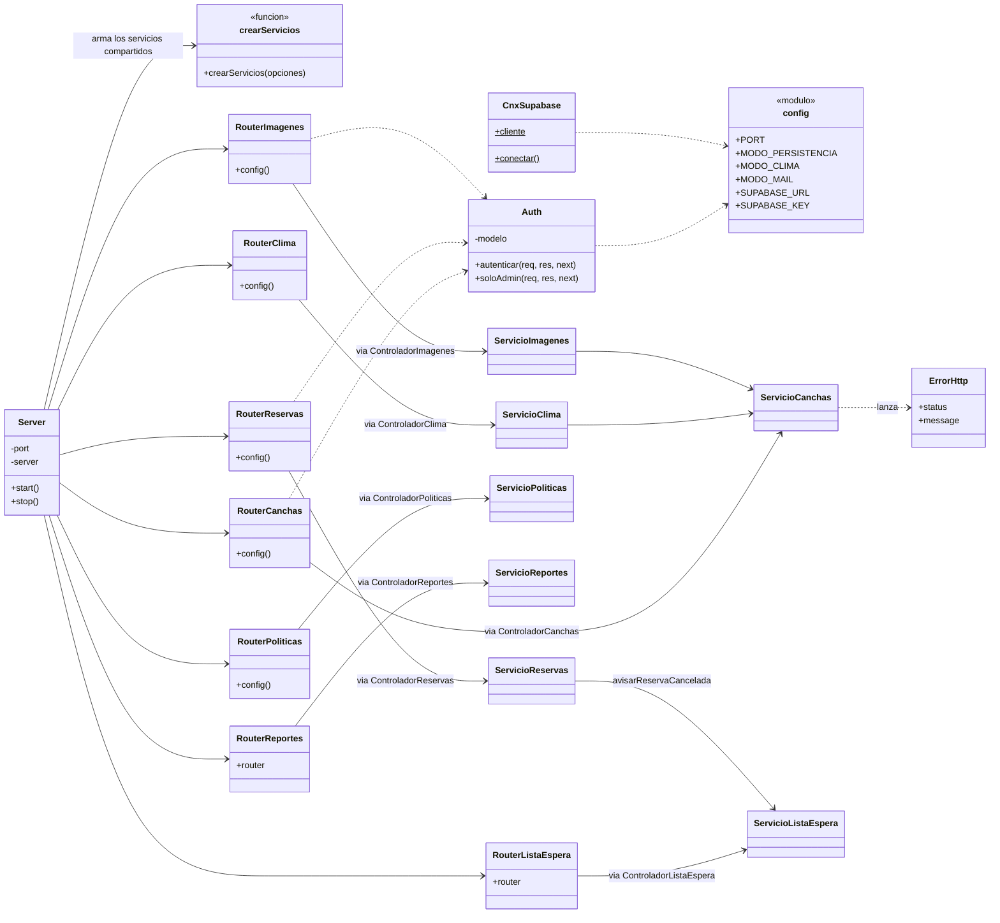
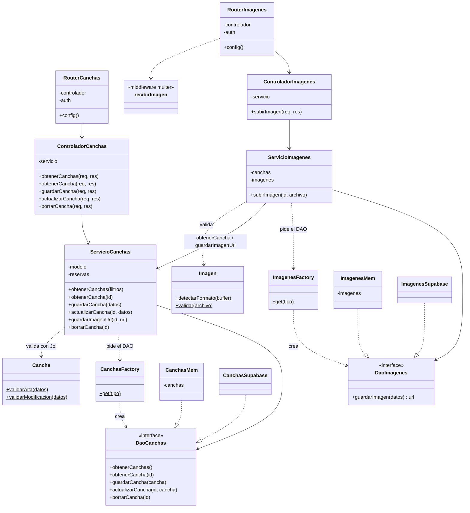

# Diagrama de clases general

Todos los recursos siguen las mismas capas (clase 11): **Router -> Controlador -> Servicio -> Factory -> DAO**. Cada DAO tiene una version en memoria (`MEM`, tests y desarrollo) y una de Supabase; la Factory elige segun `MODO_PERSISTENCIA`. Lo mismo pasa con los servicios externos (clima, mail, imagenes).

En el codigo, el router, el controlador y el servicio de cada recurso se llaman `Router`, `Controlador` y `Servicio` dentro de su archivo (por ejemplo `router/canchas.js`). En el diagrama llevan el nombre del recurso para distinguirlos.

## 1. Vista general por capas

## 2. Detalle de un recurso: canchas e imagenes (Integrante 1)

## 3. Resto de los DAOs y servicios externos

| Recurso | Factory | Version MEM | Version real |
| --- | --- | --- | --- |
| Canchas | `CanchasFactory` | `canchasMem` | `canchasSupabase` (tabla `courts`) |
| Imagenes | `ImagenesFactory` | `imagenesMem` | `imagenesSupabase` (Storage, bucket `canchas`) |
| Politicas | `politicasFactory` | `politicasMem` | `politicasSupabase` (tabla `policies`) |
| Reservas | `reservasFactory` | `reservasMem` | `reservasSupabase` (tabla `reservations`) |
| Lista de espera | `listaEsperaFactory` | `listaEsperaMem` | `listaEsperaSupabase` (tabla `waiting_list`) |
| Reportes | `reportesFactory` | `reportesMem` | `reportesSupabase` |
| Auth | `authFactory` | `authMem` (tokens fijos) | `authSupabase` (Supabase Auth + `profiles`) |
| Clima | `ClimaFactory` (`MODO_CLIMA`) | `ClimaMem` | `ClimaOpenMeteo` (API Open-Meteo) |
| Mail | `MailFactory` (`MODO_MAIL`) | `MailMem` | `MailSmtp` (nodemailer) |
