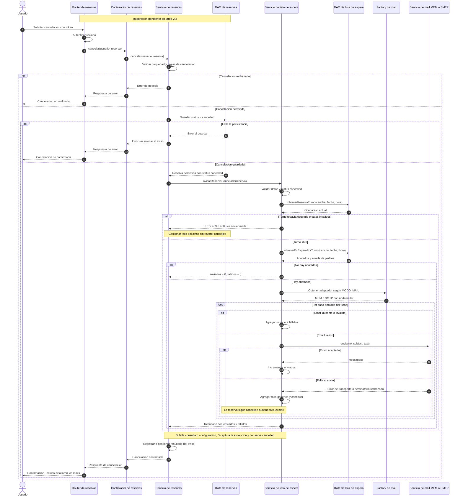

# Secuencia: aviso por mail al liberarse un turno

La busqueda de anotados y el envio MEM/SMTP estan implementados en `ServicioListaEspera.avisarReservaCancelada`. El tramo de cancelacion de reservas de la tarea 2.2 todavia debe conectarse: el diagrama describe el contrato previsto, sin fijar una ruta ni un body HTTP que aun no existen. Autenticacion, propiedad de la reserva y anticipacion minima se validan antes de guardar la cancelacion.

El servicio de reservas no debe incluir el guardado y el envio dentro de una operacion que revierta la cancelacion si el correo falla. Los errores por destinatario se devuelven como `fallidos`; las excepciones de consulta o configuracion deben capturarse en el servicio de reservas. Esa captura forma parte de la integracion pendiente, no del router de lista de espera.

MEM guarda los mensajes en un array para los tests. SMTP envia un mensaje por destinatario, sin exponer una lista de direcciones. No se reserva el turno para nadie, no se eliminan las inscripciones al avisar y no hay deduplicacion automatica si se vuelve a invocar el metodo.

Configuracion, parametros y respuestas: [README de la API](../README.md#aviso-por-mail-al-cancelar-una-reserva).
