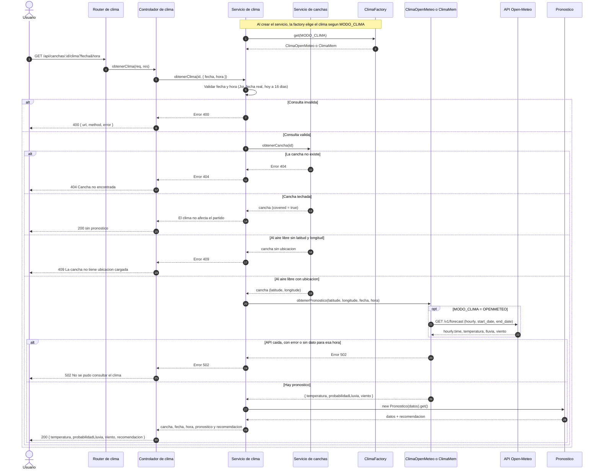

# Secuencia: consulta del clima de una cancha

`GET /api/canchas/:id/clima?fecha=YYYY-MM-DD&hora=HH:MM` es publica. El servicio de clima valida la consulta, busca la cancha con el servicio de canchas (el mismo que comparten los routers, creado en `crearServicios.js`) y, solo si es al aire libre, pide el pronostico. `ClimaFactory` elige segun `MODO_CLIMA`: `ClimaOpenMeteo` (API real) o `ClimaMem` (clima fijo para tests).

