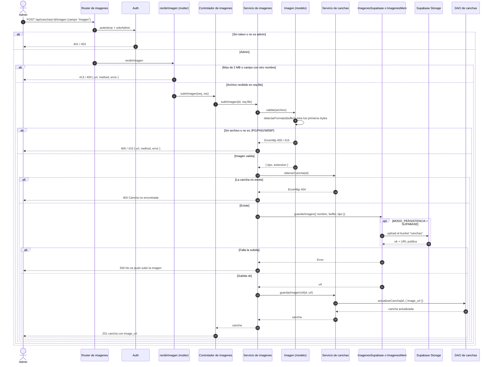

# Secuencia: subida de la imagen de una cancha

`POST /api/canchas/:id/imagen` es solo para administradores. El pedido es `multipart/form-data` con el archivo en el campo `imagen`. `multer` (middleware `recibirImagen`) deja el archivo en memoria en `req.file`; el servicio de imagenes valida el contenido real con el modelo `Imagen`, verifica la cancha con el servicio de canchas, sube el archivo con el DAO que elige `ImagenesFactory` segun `MODO_PERSISTENCIA` (`ImagenesSupabase` o `ImagenesMem`) y guarda la URL en `image_url`.

Notas:

- Los errores viajan como `ErrorHttp` hasta `manejarErrores` (`middlewares/errores.js`), que arma la respuesta `{ url, method, error }`.
- La imagen se valida **antes** de tocar la cancha o el Storage: si falla, la cancha no cambia.
- `image_url` no se puede cambiar con `PUT /api/canchas/:id`; solo subiendo una imagen.
